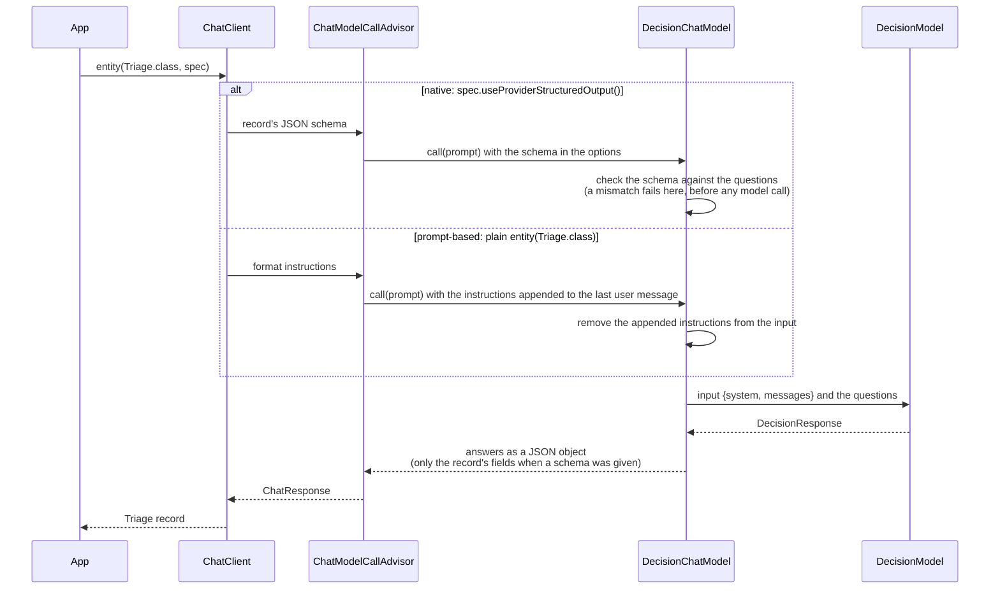

# DecisionChatModel

A decision model behind Spring AI's `ChatModel` interface, so a `ChatClient` can return
typed classifications: which team, how urgent, how severe.

```xml
<dependency>
    <groupId>org.springaicommunity</groupId>
    <artifactId>spring-ai-decision-chat</artifactId>
</dependency>
```

!!! warning "Experimental"
    `DecisionChatModel` is a prototype. Its name and behaviour may change. It lives in its
    own artifact so that it can change without touching the judge or the advisors.

## A classifier, not a generator

A `ChatModel` normally takes messages and generates a message. A decision model takes an
input and answers typed questions with numbers. `DecisionChatModel` keeps the decision model
what it is:

- **The questions are fixed when the model is built.** The prompt only supplies the input
  they are answered against. Nothing is inferred from prose.
- **The reply is the answers as a JSON object,** one field per question.
  `ChatClient.entity(...)` maps that straight onto a record.
- **What a decision model cannot do is refused, not faked.** It doesn't stream, never calls
  tools and, by default, classifies text only. Probabilities and confidence stay in
  metadata, not in the reply text.

Use it where a fast label, flag or level is what the caller needs: routing, triage,
moderation, intent detection, or any step in a workflow that only accepts a `ChatModel`.

## Quick Start

```java
record Triage(String team, double urgent, double severity) {}

DecisionChatModel triage = DecisionChatModel.builder(decisionModel)
    .question("team", ChoiceQuestion.builder()
        .text("Which team should handle the user's ticket?")
        .option("infra", "Deploys, outages, servers and errors in production")
        .option("billing", "Invoices, payments, refunds and pricing")
        .option("support", "How-to questions and account help")
        .build())
    .question("urgent", YesNoQuestion.builder()
        .text("Does the user's ticket need attention right now?")
        .whenYes("Customers are affected now")
        .whenNo("It can wait for normal working hours")
        .build())
    .question("severity", ScoreQuestion.of("How severe is the impact described in the ticket?",
        "Cosmetic", "Degraded for some users", "Full outage"))
    .build();

Triage t = ChatClient.create(triage)
    .prompt()
    .user("Production is down after the 14:00 deploy; every customer gets HTTP 500.")
    .call()
    .entity(Triage.class, spec -> spec.useProviderStructuredOutput());
// e.g. Triage[team=infra, urgent=0.97, severity=1.8]
```

Name each question after the record component its answer should land in.

## Structured output

`ChatClient.entity(...)` asks for JSON in one of two ways, and the difference decides what
the decision model sees and what is checked before the call:



`spec.useProviderStructuredOutput()` selects Spring AI's **native** structured output: the
record's JSON schema reaches `DecisionChatModel` in the options. Prefer it:

- **The input is exactly what the caller wrote.** Nothing is appended to the user message,
  so nothing is removed from it either.
- **The record is checked against the questions before any call.** A field with no question
  of the same name fails with an `IllegalArgumentException` that names the field and lists
  the questions. So does a field whose type cannot hold the answer. A choice's option needs
  a `String`, or an enum that contains every option. A yes/no probability or a score's value
  needs a floating-point type (`double`, `Double`, `float`); `int` and `boolean` are
  rejected. Shared enums (a `$ref` in the schema) and nullable fields are followed, and so
  is a schema whose top level is itself a `$ref`. A field whose schema declares no type is
  accepted without a check.
- **The reply holds exactly the record's fields.** Questions the record does not ask for are
  still answered, and are available in the metadata, but are left out of the reply. That
  keeps `spec.validateSchema()` working, since the schema forbids additional properties.
- **The target must be a single object.** A record or class is fine; a `List<...>` target,
  or a schema that offers several alternative shapes at its top level, is rejected before
  any call.

With plain `.entity(Triage.class)`, Spring AI uses **prompt-based** structured output
instead. It appends format instructions to the last user message, and the default input
removes them again. There is no schema check, and the reply contains every answer.

### What is removed, and what never is

The instructions are removed only when the message **ends with exactly** the block Spring
AI's `BeanOutputConverter` or `MapOutputConverter` produces. The wording is read from those
converters at runtime rather than copied, so it follows the Spring AI version in use.

This is deliberately strict, because the text of a user message is what gets classified. A
message that merely quotes one of the format sentences, or carries text after them, is the
user's content and is sent in full. Otherwise a user could hide text from a moderation
classifier by writing those sentences in front of it.

`ListOutputConverter` is rejected, since it asks for comma-separated values, which a JSON
object cannot satisfy. It is recognised the same strict way, and never on the native path.

!!! note "One limit of the strict match"
    A user who appends a complete, well-formed copy of the format block to their own message
    still has that block removed, including any text placed inside its JSON schema. On the
    native path nothing is ever removed, which is one more reason to prefer it.

## What comes back

The reply is a JSON object, one field per question, in declaration order. With native
structured output it holds only the record's fields.

| Question | Field value | Example |
|---|---|---|
| `YesNoQuestion` | the probability of yes, `0..1` | `"urgent": 0.97` |
| `ChoiceQuestion` | the selected option | `"team": "infra"` |
| `ScoreQuestion` | its value on the rubric, `0..` highest level | `"severity": 1.8` |
| a question the model [refused](../concepts/decision-models.md#refusals) | `null` | `"team": null` |

```java
String json = ChatClient.create(triage).prompt().user(ticket).call().content();
// {"team":"infra","urgent":0.97,"severity":1.8}
```

The full `DecisionResponse`, with every answer, probability and confidence, is in the
generation metadata. The response metadata carries the model, the token usage and, when the
provider reports one, the response id:

```java
ChatResponse response = ChatClient.create(triage).prompt().user(ticket).call().chatResponse();

DecisionResponse decision = response.getResult().getMetadata().get(DecisionChatModel.RESPONSE_METADATA_KEY);
Double infra = decision.getChoice("team").getProbability("infra");   // null when not reported

response.getMetadata().getModel();
response.getMetadata().getUsage().getPromptTokens();
```

## What the decision model sees

By default, the prompt becomes a fields input:

```json
{
  "system": "Tickets come from enterprise customers.",
  "messages": [ { "role": "user", "content": "Production is down after ..." } ]
}
```

- **`system`** (`DecisionChatModel.SYSTEM_FIELD`) holds every system message, joined with a
  blank line. It is left out when there are none.
- **`messages`** (`DecisionChatModel.MESSAGES_FIELD`) holds the user and assistant turns, in
  order.
- **Format instructions:** on the prompt-based path, the instructions appended to the
  **last** user message are removed, as described [above](#structured-output). Earlier
  messages are left untouched.
- **Media:** a message carrying media is rejected with `IllegalArgumentException`. The
  default input carries text only.

Write the questions in terms of that input, for example "the user's ticket". To judge a
different shape, or to send media to a provider that reads it, supply your own converter:

```java
DecisionChatModel.builder(decisionModel)
    .questions(questions)
    .inputConverter(prompt -> DecisionInput.fields(Map.of("ticket",
        DecisionChatModel.withoutFormatInstructions(prompt.getUserMessage().getText()))))
    .build();
```

A custom converter receives the prompt as sent. On the prompt-based path that includes the
appended format instructions, so remove them with
`DecisionChatModel.withoutFormatInstructions`, as above, or use native structured output.
A converter can return any `DecisionInput`, including `DecisionInput.conversation(...)`.

## Builder Configuration

| Builder method | Default | Description |
|---|---|---|
| `question(String, DecisionQuestion)` | — (**at least one**) | A question every call answers. The name is the reply's field. |
| `questions(Map<String, ? extends DecisionQuestion>)` | — | Several questions at once, in map order. |
| `options(DecisionOptions)` | the model's defaults | Options sent with every call. Their model name is also what `getOptions()` and the observations report. |
| `inputConverter(Function<Prompt, DecisionInput>)` | `DecisionChatModel::defaultInput` | How a prompt becomes the input. |
| `answerRenderer(Function<DecisionResponse, String>)` | `DecisionChatModel::answersAsJson` | How the answers become the reply's text. A custom renderer owns the reply's shape, so the native schema check is skipped. |
| `provider(String)` | `"decision"` | The provider name reported on observations. |
| `observationRegistry(ObservationRegistry)` | `ObservationRegistry.NOOP` | Observe each call; see [observability](#observability). |
| `observationConvention(ChatModelObservationConvention)` | `DefaultChatModelObservationConvention` | Replace the observation's name and key values. |

A model named in the prompt's `ChatOptions` is used for that call; otherwise the one in the
builder's `options(...)`, and failing that the decision model's own default.

## What it refuses

| Chat-model feature | `DecisionChatModel` |
|---|---|
| `stream(...)` | errors with `UnsupportedOperationException`. A decision model answers every question at once. |
| Tools given to `ChatClient` | dropped. `getOptions()` are not tool-calling options, so `ChatClient` never starts its tool loop. |
| A `Prompt` carrying tool callbacks directly | rejected with `IllegalArgumentException`. |
| Media in a message | rejected with `IllegalArgumentException` by the default input. |
| List output (`ListOutputConverter`) | rejected with `IllegalArgumentException`. |
| Temperature, top-p, max tokens | ignored; a decision model has no such settings. |

Advisors still run. Memory or retrieval advisors only add text to the input, though; they
don't make the model generate anything.

## Observability

Each call is observed like any other Spring AI chat model: a `gen_ai.client.operation`
observation, contextually named `chat <model>`.

| Key | Value |
|---|---|
| `gen_ai.operation.name` | `chat` |
| `gen_ai.system` | `decision` (`DecisionChatModel.DEFAULT_PROVIDER`), or the builder's `provider(...)` |
| `gen_ai.request.model` | the model sent: the prompt's, or the builder's options' |
| `gen_ai.response.model` | the model that answered, when the provider reports it |
| `gen_ai.response.id` | the response id, when the provider reports it |
| `gen_ai.response.finish_reasons` | always `["STOP"]` |
| `gen_ai.usage.input_tokens` / `output_tokens` / `total_tokens` | the token counts the decision model reports |

The `DecisionModel` API does not say which provider is behind a model, so name it yourself
when it matters in your dashboards:

```java
DecisionChatModel.builder(decisionModel)
    .questions(questions)
    .provider("ollama")
    .observationRegistry(observationRegistry)
    .build();
```

With Spring AI's `ChatModelMeterObservationHandler` registered, token usage is also recorded
as `gen_ai.client.token.usage`. The decision model's own `decision` observation nests inside
this one.

## With Spring Boot

Expose a `ChatClient` built on the model, **not** the model itself. Pass the
`ObservationRegistry` to both, so the `ChatClient` and advisor observations are recorded
alongside the model's:

```java
@Bean
ChatClient triageClient(DecisionModel decisionModel, ObservationRegistry observationRegistry) {
    DecisionChatModel triage = DecisionChatModel.builder(decisionModel)
        .questions(TRIAGE_QUESTIONS)
        .observationRegistry(observationRegistry)
        .build();
    return ChatClient.create(triage, observationRegistry);
}
```

!!! warning "Do not declare a `DecisionChatModel` bean"
    A `DecisionChatModel` is a `ChatModel`. Declared as a bean next to the application's
    real model, it makes two `ChatModel` beans. Then any injection of Spring AI's
    auto-configured `ChatClient.Builder`, or of a bare `ChatModel`, fails with
    `NoUniqueBeanDefinitionException`. Marking the real model `@Primary` removes the error,
    but leaves a classifier registered as a `ChatModel` for anything that collects them all;
    marking the `DecisionChatModel` `@Primary` makes every other `ChatClient` use it
    silently. Build the model inside the method that creates its `ChatClient`, as above, and
    inject that client by name.

The `DecisionModel` bean comes from the [provider's starter](../concepts/providers.md).

## When to use something else

- A verdict on a model's answer, with thresholds and feedback:
  [`DecisionJudge`](../judge/DecisionJudge.md).
- Judging and retrying inside a chat call:
  [`DecisionSelfRefineAdvisor`](../self-refine/DecisionSelfRefineAdvisor.md).
- No `ChatClient` needed: call the [`DecisionModel`](../concepts/decision-models.md)
  directly. It is the same request, without the adapter.

## See Also

- [Decision Models](../concepts/decision-models.md)
- [Confidence](../concepts/confidence.md): what the probabilities in the metadata mean
