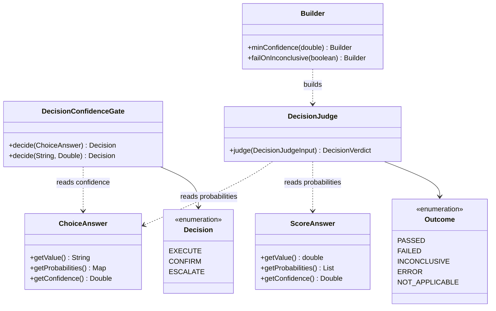
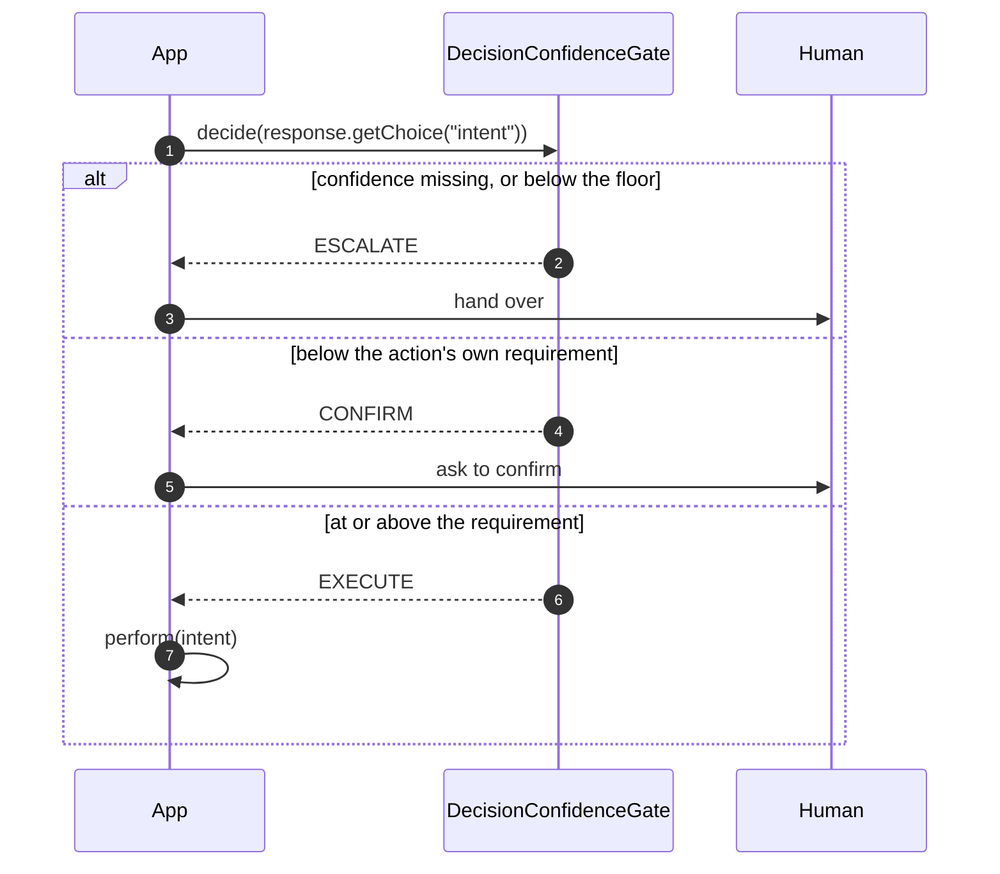

# Confidence

Confidence is a second axis. **The answer tells you what; confidence tells you whether to
act on it unattended.**

## What it actually measures

`ChoiceAnswer` and `ScoreAnswer` carry `getConfidence()`: the provider's own estimate,
between `0` and `1`, of how sure it is about the whole answer. It reflects how well the
options or levels separated *for this input*.

A low value is not the same as the answer being wrong. It means the question did not decide
cleanly, which is a different problem and wants a different response: not "reject this
answer", but "do not let software act on this one alone".

!!! note "Yes/no answers carry no confidence, by design"
    A yes/no answer's probability already *is* its certainty. A `0.5` is the undecided case,
    so there is nothing a separate statistic would add. Only choices and scores report
    confidence.

!!! warning "Confidence can be missing"
    `getConfidence()` is `null` when the provider doesn't report it, and with Ollama and
    System One a value of `0` can also mean "none reported". The components here treat a
    missing confidence as the cautious case: the [gate](../patterns/DecisionConfidenceGate.md)
    escalates, and the [judge](../judge/DecisionJudge.md) reads the probabilities rather than
    the confidence.

## Two things read it

The gate and the judge are the two components that act on certainty, and they ask different
questions of it.



## Confidence-gated routing

Tier your thresholds by what the action costs when it is wrong. A universal floor keeps
anything genuinely undecided away from automation; above it, expensive actions demand more
than cheap ones.

[`DecisionConfidenceGate`](../patterns/DecisionConfidenceGate.md) holds that policy in one
place:

```java
DecisionConfidenceGate gate = DecisionConfidenceGate.builder()
    .floor(0.60d)                     // nothing acts unattended below this
    .require("transfer_funds", 0.85d) // this one costs more when wrong
    .build();

switch (gate.decide(response.getChoice("intent"))) {
    case EXECUTE  -> perform(intent);
    case CONFIRM  -> askTheUserToConfirm(intent);
    case ESCALATE -> handOverToAHuman();
}
```



The two thresholds are independent: the floor is about the answer being undecided at all,
the per-action requirement is about what the action costs when it is wrong.

| Confidence | Low-stakes action | High-stakes action |
|------------|-------------------|--------------------|
| missing, or below the floor | escalate | escalate |
| floor … requirement | execute | ask the user to confirm |
| at or above requirement | execute | execute |

Thresholds are properties of the model that answers. Tuned on one model, they don't carry
over to [another provider](providers.md#thresholds-do-not-carry-over); measure them again
there.

## Confidence in the judge

[`DecisionJudge`](../judge/DecisionJudge.md) makes a pass/fail decision, so it asks a
narrower question than `getConfidence()` does. Not *how sure is the provider about the
answer?* but *how much of the probability supports this verdict?*: the probability on the
verdict's side of the threshold.

The two differ when the probability is split between levels that all pass, or all fail.
Probabilities of `0.52` on level 2 and `0.41` on level 3, against a minimum of 2, come with
a confidence near `0.5`, yet 93% of the probability supports the pass.

A criterion whose verdict is not supported by enough probability is **undecided, not
failed**. It is reported as `INCONCLUSIVE` and does not block:

```java
DecisionJudge judge = DecisionJudge.builder(decisionModel)
    .score("helpfulness", rubric, 2.0d)
    .minConfidence(0.6d)          // the default: a clear majority must support the verdict
    .failOnInconclusive(false)    // the default: undecided does not block
    .build();
```

When the provider reports no probabilities, the judge uses the answer's own confidence
instead. When it reports neither, there is nothing to gate on and the answer is acted on as
given.

`DecisionConfidenceGate` still reads `getConfidence()` itself, because routing an action is
a different decision: there, how clearly *one* option won is exactly the question.

Turn `failOnInconclusive(true)` on where shipping an unverified answer is worse than
failing. Leaving it off is right when an occasional unverifiable answer is acceptable and a
false rejection is not.

## Stability is a different question

Confidence describes one answer. It says nothing about whether you would get the same answer
again, and a value that lands near a threshold may be noise rather than judgement.

[`DecisionConsistency`](../patterns/DecisionConsistency.md) answers that by sampling:

```java
DecisionConsistency.Report report = DecisionConsistency.sample(decisionModel, fields, questions, 15);

// The questions whose samples straddle the threshold you are about to rely on
List<String> shaky = report.unstableAt(0.70d);
```

A criterion whose samples fall on both sides of its threshold makes a decision that is not
reproducible. Either move the threshold, sharpen the question, or route that case to a
human.

## See Also

- [DecisionConfidenceGate](../patterns/DecisionConfidenceGate.md): the gate as a reusable policy
- [DecisionConsistency](../patterns/DecisionConsistency.md): measuring stability across samples
- [Decision Models](decision-models.md)
