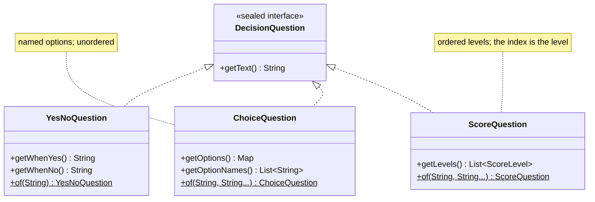
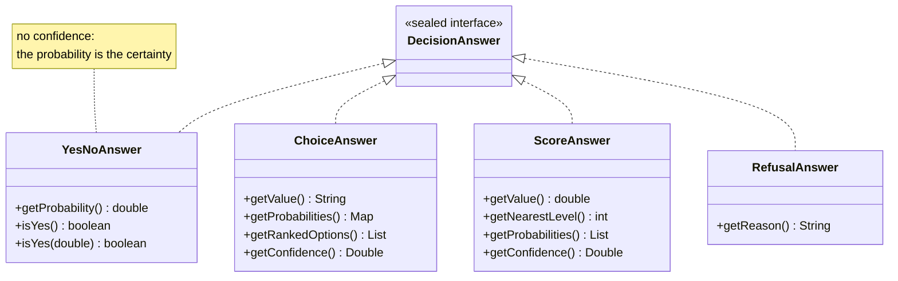
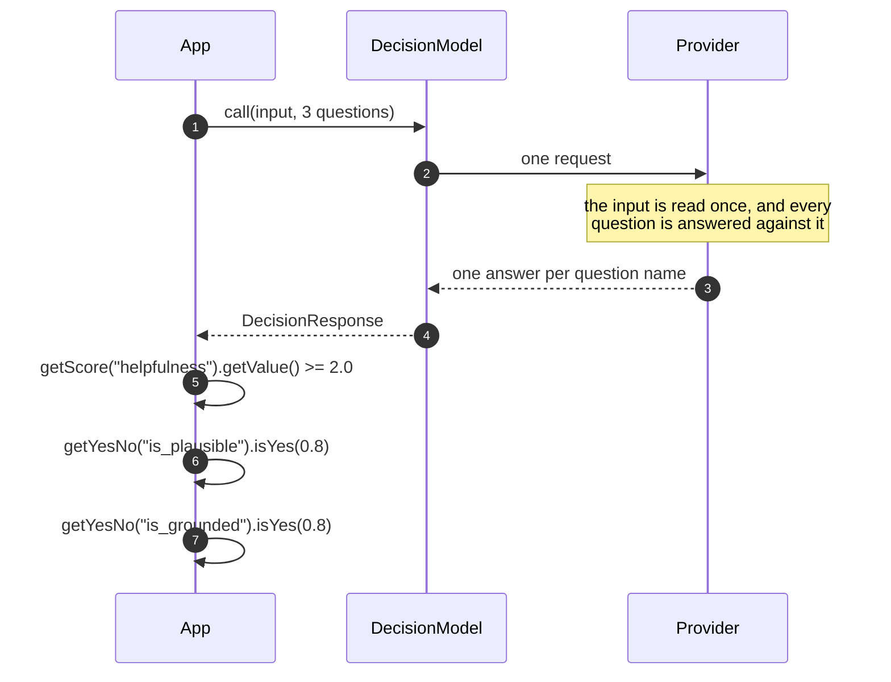

# Decision Models

Everything in this project is built on the Spring AI `DecisionModel` API. This page is a
short tour of it; the
[Spring AI reference](https://docs.spring.io/spring-ai/reference/2.1-SNAPSHOT/models/decision.html) is the
full description.

## What a decision model is

Many decisions in an application have a small, known set of possible results: yes or no,
one of a few categories, or a level on a scale. You could ask a chat model, but it answers
with free text, and you must turn that text into a reliable yes or no yourself.

A decision model is made for these decisions. You describe the possible results, and the
model picks one and tells you how likely each result is. It is usually faster and cheaper
than a chat model asked the same thing, and because it reports probabilities, your
application decides how sure the model must be before it acts.

!!! note "Still a model, not a rule engine"
    A decision model's answers are not deterministic, and they can be wrong. For each
    decision, think about what happens when the answer is wrong. When a mistake is
    expensive, let a person check the answer or use a safe default.

## Asking questions

A `DecisionPrompt` holds the input, the questions to ask about it and, optionally, the
settings of the call.

```java
DecisionResponse response = decisionModel.call(DecisionPrompt.builder()
    .text("My new headphones arrived yesterday, but the left side doesn't work. Can I get my money back?")
    .question("defect", YesNoQuestion.builder()
        .text("Does the customer report a defect?")
        .whenYes("Part of the item does not work as it should")
        .whenNo("The item works, and the message is about something else")
        .build())
    .question("topic", ChoiceQuestion.builder()
        .text("What is the message about?")
        .option("delivery", "Where an order is, or when it will arrive")
        .option("product", "A problem with an item the customer received")
        .option("account", "Login, address or payment details")
        .option("other", "None of the above")
        .build())
    .question("satisfaction", ScoreQuestion.of("How satisfied is the customer?", "unhappy", "neutral", "happy"))
    .build());

boolean defect = response.getYesNo("defect").isYes();
String topic = response.getChoice("topic").getValue();
int satisfaction = response.getScore("satisfaction").getNearestLevel();
```

When you have only a text and one or two questions, `call(String, Map)` is shorter:

```java
DecisionResponse response = decisionModel.call("Where is my order? I ordered it two weeks ago.",
        Map.of("topic", ChoiceQuestion.of("What is the message about?",
                "delivery", "product", "account", "other")));
```

## The three questions

There are three kinds of questions, and every provider supports all three. Each answers
differently, and each is thresholded differently, which is the reason to pick deliberately
between them.

| Question | What it asks | Answer |
|----------|--------------|--------|
| `YesNoQuestion` | Whether something is true. Optional `whenYes` and `whenNo` criteria say what counts as a yes and what counts as a no. | `YesNoAnswer`, with the probability of yes |
| `ChoiceQuestion` | Which of the offered options fits the input. Each option has a name and, optionally, a description. | `ChoiceAnswer`, with the selected option and, when the provider reports them, the probability of each option |
| `ScoreQuestion` | Which level of an ordered scale fits the input. Each level has a label and, optionally, a description. | `ScoreAnswer`, with the expected level and, when the provider reports them, the probability of each level |



`DecisionQuestion` and `DecisionAnswer` are sealed interfaces. A `switch` over a question or
an answer can cover every kind, and the compiler checks that none is missing.

### Yes/no

A yes/no question's answer is a probability rather than a boolean. There is no separate
confidence, because a probability of `0.5` already tells you the model is undecided.

Adding `whenYes` and `whenNo` descriptions is what turns a vague question into a usable one.
They also become the defect text a [judge](../judge/DecisionJudge.md) feeds back, so write
them as statements about the input rather than instructions to a model:

```java
YesNoQuestion plausible = YesNoQuestion.builder()
    .text("Are all the numeric values physically plausible for their units?")
    .whenYes("Every value is within a range that can actually occur")
    .whenNo("At least one value is impossible, such as a temperature below absolute zero")
    .build();
```

### Choice

A choice picks exactly one option from a fixed set.

!!! warning "A choice always names an option"
    A `ChoiceAnswer` names an option even when none of them fits. When "none of these" is a
    real outcome in your domain, ask it as a separate `YesNoQuestion` next to the choice, or
    add an explicit `other` option.

### Score

A score places the input on an ordered rubric you define. Its value is **continuous**: the
expected level, weighted by the probabilities. A `1.1` on a three-level rubric sits just
past the second level, leaning toward the third.

Because the value is continuous, a threshold of `2.0` is a real threshold and not a rounding
artefact. Keep the levels genuinely ordered. If two levels are alternatives rather than
degrees, you want a choice.

## Inputs

The input is what the questions are about. `DecisionInput` offers three kinds, and the
`DecisionPrompt` builder has a method for each.

| Input | Use it for |
|-------|-----------|
| `text(String)` | A plain text, such as a customer message. For a text with images, use `content(MessagePart...)`. |
| `fields(Map)` | An input made of named fields. The model gets each value with its name, so it knows what each value means. Values can be strings, numbers, booleans, nulls, maps and lists. |
| `conversation(List<Message>)` | A conversation, made of the same `Message` types that a `ChatModel` takes. Use it to check an exchange. |

```java
Map<String, Object> customer = new LinkedHashMap<>();
customer.put("message", "This is the third time my order arrives late.");
customer.put("orders", 12);
customer.put("late_deliveries", 3);

DecisionResponse repeated = decisionModel.call(DecisionInput.fields(customer),
        Map.of("repeated", YesNoQuestion.of("Does the customer say that the problem happened before?")));
```

Naming a field in a question's text (`` `message` ``) is how you point a question at one
part of a fields input instead of the whole thing. The judge and the guardrail both work
this way: their questions refer to `assistant_answer`, `tool_calls` or `text` by name.

!!! tip "Use a `LinkedHashMap` for fields"
    The model reads the fields in the order they are sent, and some models answer
    differently when that order changes. `Map.of(...)` has no order, so it can change
    between JVM runs.

Not every provider supports every kind of input or content part, such as images. See
[Providers](providers.md).

## Reading answers

A `DecisionResponse` holds one answer for each question, and the metadata of the call. Get
an answer by its name, with the method for its kind: `getYesNo(name)`, `getChoice(name)` or
`getScore(name)`.



**Yes/no.** `getProbability()` is the probability of yes. `isYes()` answers yes at `0.5`
or above; with `isYes(double)` you choose the threshold:

```java
// open a repair ticket automatically only when the model is very sure
boolean defect = response.getYesNo("defect").isYes(0.9);
```

**Choice.** `getValue()` is the selected option. When the provider reports them,
`getProbability(option)` and `getRankedOptions()` give the probability of each option. If
the selected option is only a little more likely than the second one, the input is not
clear, and a person may handle it better.

**Score.** There are three ways to read a score:

- `getNearestLevel()`: the position of the most likely level, starting at `0`. Use this one
  to act on.
- `getValue()`: the expected level, the average level weighted by the probabilities. A
  decimal number between `0` and the number of levels minus one.
- `getRoundedLevel()`: the expected level, rounded to the nearest level.

The expected level can be a level that the model thinks is unlikely:

```java
// probabilities 0.5, 0, 0.5 over the levels unhappy, neutral, happy
ScoreAnswer satisfaction = response.getScore("satisfaction");
satisfaction.getNearestLevel();  // 0, unhappy: as likely as happy, and the first one wins
satisfaction.getValue();         // 1.0, the average level weighted by the probabilities
satisfaction.getRoundedLevel();  // 1, neutral, which has no probability at all
```

### Probabilities and confidence

The probabilities are the values the model gives to each possible result. They don't
guarantee that the answer is correct, and you can't compare them across models, or across
questions with different wording. Choose your thresholds by testing on real examples from
your application, and test them again when you change the model.

`ChoiceAnswer` and `ScoreAnswer` also have `getConfidence()`, the provider's own estimate of
how sure it is about the whole answer. It is `null` when the provider doesn't report it.
[Confidence](confidence.md) covers what it means and how this project uses it.

### Refusals

A provider can refuse to answer one question and still answer the others. That question gets
a `RefusalAnswer`, and `response.isRefused(name)` returns `true` for it. The typed getters,
such as `getYesNo(name)`, throw an `IllegalStateException` for a refused question. A refusal
doesn't make the call fail.

The components in this project never read a refusal as an answer:

| Component | A refused question |
|-----------|--------------------|
| [`DecisionJudge`](../judge/DecisionJudge.md) | is an `ERROR` finding: not a pass, but it fails the verdict only with `failOnError(true)` |
| [`DecisionGuardrail`](../guardrails/DecisionGuardrailAdvisor.md) | counts as if the hazard fired, so the turn is refused |
| [`DecisionChatModel`](../chat/DecisionChatModel.md) | is `null` in the reply |
| [`DecisionConsistency`](../patterns/DecisionConsistency.md) | is left out of the statistics |

### Metadata

`response.getMetadata()` has the token usage of the call. When the provider reports them, it
also has the response id and the model that answered.

## Atomic questions, composed in code

The most important habit is asking several narrow questions instead of one broad one. The
providers answer every question of a call against the same input, so a third question costs
far less than a third call.

```java
DecisionResponse response = decisionModel.call(DecisionPrompt.builder()
    .input(input)
    .question("helpfulness",  helpfulnessRubric)    // ScoreQuestion
    .question("is_plausible", plausibilityCheck)    // YesNoQuestion
    .question("is_grounded",  groundednessCheck)    // YesNoQuestion
    .build());
```



The payoff is that each answer keeps its own threshold. An answer that is fluent and exactly
on topic but quotes an impossible temperature fails on `is_plausible` alone. A single
overall rating would average that problem away into a middling score.

A few more habits give more reliable answers:

- **Pick the kind of question from what your code does next.** A yes/no question when the
  code takes one of two paths, a choice when it takes one of several, a score when it needs
  a level.
- **Add descriptions when a name alone can be read in more than one way.** The `whenYes` and
  `whenNo` criteria do the same for a yes/no question.
- **Send only what the decision needs.** A short message, or a few relevant fields, gives
  clearer answers than a whole customer record or a long conversation.
- **Try your questions on real inputs before you rely on them,** including inputs that are
  hard to decide. If the probabilities stay close to `0.5`, or are spread over several
  options, change the wording and try again.

### Speculative questions

Since extra questions are cheap, ask ones you might not need. `bug_severity` only matters if
a ticket turns out to be a technical report, but which it is is what the call is working
out. Ask both and let your code decide what to read:

```java
switch (response.getChoice("department").getValue()) {
    case "technical" -> handleBug(response.getScore("bug_severity").getValue());
    case "billing"   -> handleBilling(response.getYesNo("refund_requested").getProbability());
    default          -> route(response);
}
```

## Options

`DecisionOptions` holds the settings of a call, such as the model to use. Set it on the
prompt to change the model's defaults for one call:

```java
DecisionPrompt prompt = DecisionPrompt.builder()
    .text("Where is my order? I ordered it two weeks ago.")
    .question("topic", ChoiceQuestion.of("What is the message about?",
            "delivery", "product", "account", "other"))
    .options(DecisionOptions.builder().model("d1-omni:2b").build())
    .build();
```

The components here that call a model take the same options: `DecisionJudge.builder(...)`,
`DecisionGuardrailAdvisor.builder(...)` and `DecisionChatModel.builder(...)` each have an
`options(DecisionOptions)` method, sent with every call they make.

## See Also

- [Providers](providers.md): the available implementations and what each supports
- [Confidence](confidence.md): when to act on an answer automatically
- [DecisionJudge](../judge/DecisionJudge.md): composing criteria into a pass/fail verdict
- [Spring AI Decision Models reference](https://docs.spring.io/spring-ai/reference/2.1-SNAPSHOT/models/decision.html)
