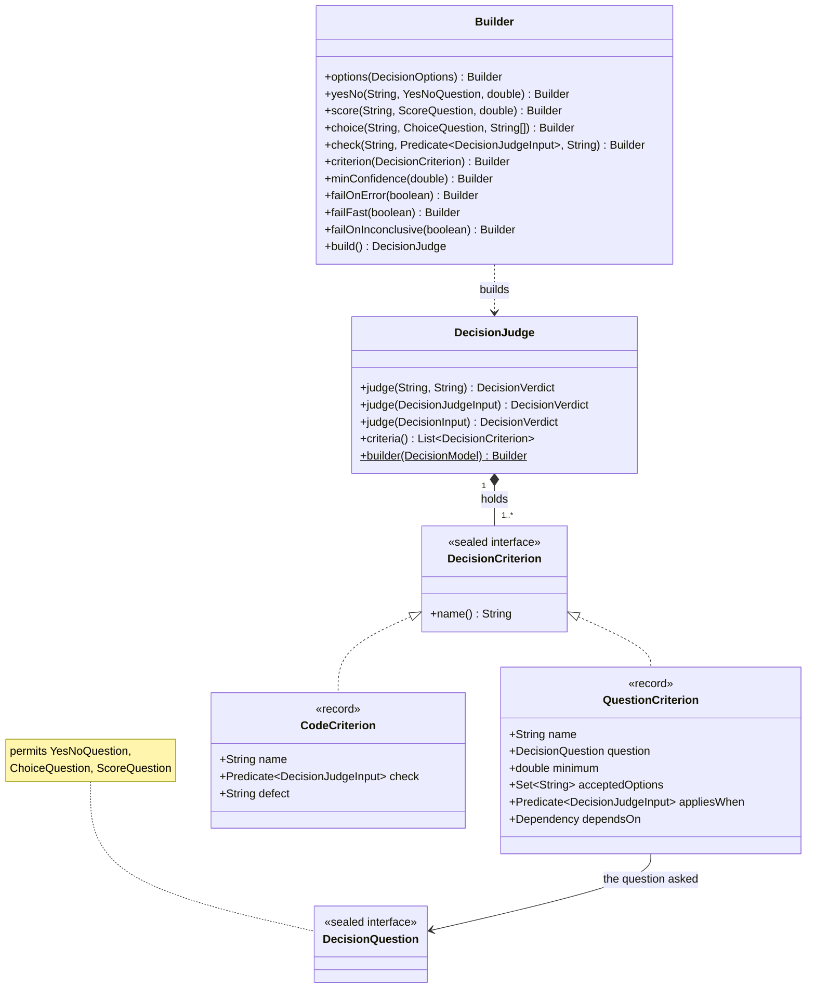
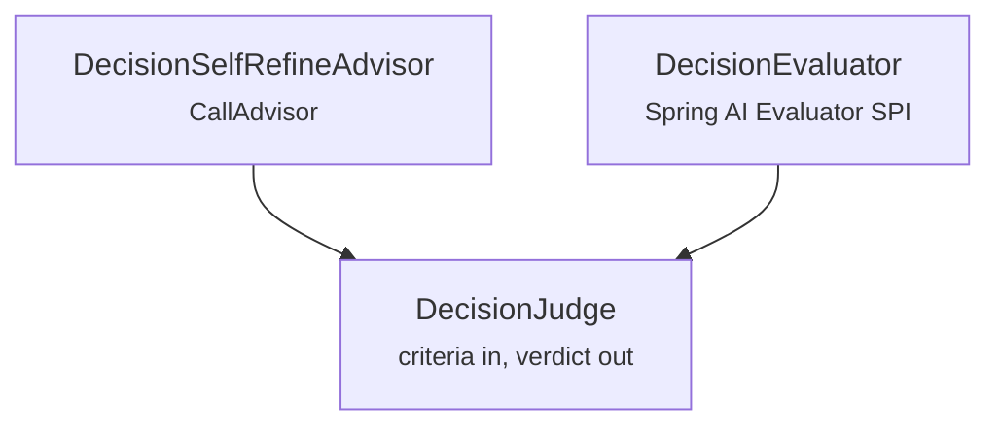
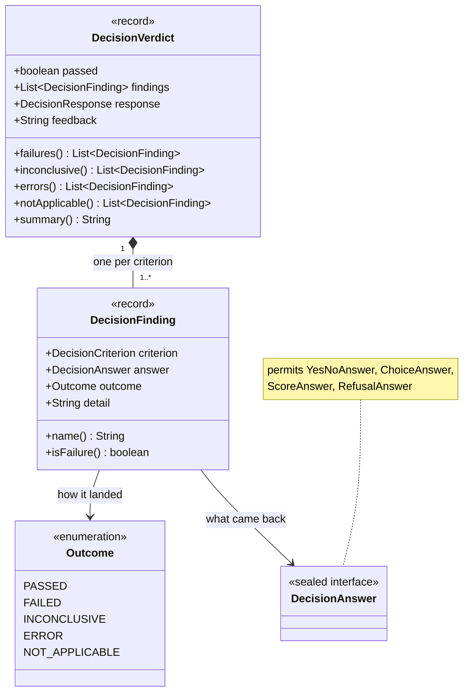

# DecisionJudge

A model-as-a-judge built out of atomic questions rather than one rubric prompt. Every
criterion is answered against the same input in a single call, and each keeps its own
threshold.

```xml
<dependency>
    <groupId>org.springaicommunity</groupId>
    <artifactId>spring-ai-decision-judge</artifactId>
</dependency>
```

The judge needs only the `DecisionModel` API, so it can be used in a test suite or a batch
evaluation without `ChatClient`.

## What it does

A judge holds a list of criteria. Most are a [question](../concepts/decision-models.md) plus
what counts as passing it:

- a **yes/no** question passes when its probability of yes reaches a minimum
- a **score** passes when at least half of its probability is on the levels at or above
  your minimum
- a **choice** passes when at least half of its probability is on the options you accept

See [how a verdict is decided](#low-confidence-is-undecided-not-failed) for the details.

The rest are [**code checks**](#code-criteria): plain Java predicates for anything the input
already settles, such as whether a tool was called. They never reach the model.

`judge(...)` sends every question in one request and returns a `DecisionVerdict`: whether
everything passed, a finding per criterion, the raw response, and feedback synthesised from
the criteria that did not.

## Class diagram

A judge is built from criteria, and each criterion pairs a question with its own pass
condition:



The shape to take from this: a judge is **a list of criteria and nothing else**. It holds a
`DecisionModel` and spends at most one call per `judge(...)`, whatever the number of
criteria. It makes none when no question applies, or when `failFast` skips it. Code checks
run locally and add nothing to that.

## How the judge, the advisor and the evaluator fit together

These three are a **hub and two spokes**, not a chain. `DecisionJudge` is the engine; the
other two are independent adapters that put it behind a Spring AI extension point. Neither
spoke uses the other.



| Type | Use it when |
|------|-------------|
| `DecisionJudge` (this page) | you want a verdict in your own code, with the per-criterion findings |
| [`DecisionSelfRefineAdvisor`](../self-refine/DecisionSelfRefineAdvisor.md) | a `ChatClient` should judge its own answer and retry when it falls short |
| [`DecisionGuardrailAdvisor`](../guardrails/DecisionGuardrailAdvisor.md) | a turn should be refused rather than retried: an unsafe answer is not a draft |
| [`DecisionEvaluator`](DecisionEvaluator.md) | existing code is written against Spring AI's `Evaluator`, and you want a decision model behind it |

`DecisionGuardrailAdvisor` is the odd one out: it builds its own hazard batteries rather
than taking a `DecisionJudge`, because the questions and thresholds are prescribed by the
guardrail policy rather than supplied per use.

## Why not just ask a chat model

Spring AI ships `RelevancyEvaluator` and `FactCheckingEvaluator`. Both prompt a second chat
model and read a yes or a no out of its reply. That fails in two directions. The model may
answer in a form the parser does not expect, and one yes-or-no cannot say *which* of several
things was wrong. A judge built from typed questions cannot come back malformed, and keeps
the dimensions separate.

| | A judge model | `DecisionJudge` |
|---|---|---|
| **Verdict** | prose to parse | typed answers |
| **Dimensions** | one overall rating | one threshold per criterion |
| **Cost of a third check** | a third prompt, or a longer one | negligible: same call |
| **Feedback** | generated, varies run to run | synthesised from your own rubric |
| **Undecided** | indistinguishable from failed | reported as `INCONCLUSIVE` |
| **Could not judge** | indistinguishable from failed | reported as `ERROR` |

## Quick Start

```java
DecisionJudge judge = DecisionJudge.builder(decisionModel)
    .score("helpfulness", ScoreQuestion.builder()
        .text("How well does `assistant_answer` address `user_question`?")
        .level("Terrible: irrelevant or off-topic")
        .level("Mostly unhelpful: misses the main point")
        .level("Mostly helpful: minor gaps remain")
        .level("Excellent: fully and correctly addressed")
        .build(), 2.0d)
    .yesNo("is_plausible", YesNoQuestion.builder()
        .text("Are the numeric values in `assistant_answer` physically plausible?")
        .whenNo("At least one value is impossible")
        .build(), 0.7d)
    .build();

DecisionVerdict verdict = judge.judge(question, answer);

if (!verdict.passed()) {
    System.out.println(verdict.feedback());
}
```

## The input a judge builds

`judge(String question, String answer)` builds a two-field input:

```json
{ "user_question": "...", "assistant_answer": "..." }
```

When there is more to judge against, build a `DecisionJudgeInput`. Its fields become the
input under fixed names, the same wherever a judge is used, so write your questions against
them:

| Builder method | Input field | Shape |
|---|---|---|
| `question(String)` | `user_question` | string |
| `answer(String)` | `assistant_answer` | string |
| `expected(Object)` | `expected_output` | a string, number, boolean, map or list: the reference to judge against |
| `context(String)` / `context(List<String>)` | `supporting_context` | list, one entry per document |
| `toolCall(ToolCall)` / `toolCalls(List<ToolCall>)` | `tool_calls` | list of `{name, arguments, result}` |
| `field(String, Object)` | the name you give | anything else |

```java
DecisionVerdict verdict = judge.judge(DecisionJudgeInput.builder()
        .question("Will I need an umbrella in Dublin tomorrow?")
        .answer(answer)
        .expected("Rain is likely; bring an umbrella.")
        .field("search_required", true)
        .toolCalls(toolCalls)
        .build());
```

Empty context and tool-call lists are left out rather than sent as empty lists, so a
criterion can tell "no evidence" from "evidence that says nothing". The constants live on
`DecisionJudgeInput` (`QUESTION_FIELD`, `EXPECTED_FIELD`, `TOOL_CALLS_FIELD`, ...).

A value the model input cannot carry, such as an arbitrary object, is rejected when the
input is built, with a message naming the field.

For anything that is not a question-and-answer pair, pass the input yourself. Any
`DecisionInput` works: fields, a plain text or a conversation.

```java
DecisionVerdict verdict = judge.judge(DecisionInput.fields(Map.of(
        "passage", retrievedText,
        "claim",   claimUnderTest)));
```

## Code criteria

Some criteria need no model, because the answer is already in the input: whether the agent
searched when it had to, whether the answer parses, whether it matches the expected output
exactly. Declare those as **checks**:

```java
DecisionJudge judge = DecisionJudge.builder(decisionModel)
    .check("matches_search_expectation",
           input -> !input.toolCalls().isEmpty()
                   == Boolean.TRUE.equals(input.field("search_required", Boolean.class)),
           "searched when no search was required, or skipped a required search")
    .yesNo("is_grounded", groundedQuestion, 0.7d)
    .build();
```

A check is a `Predicate<DecisionJudgeInput>` plus the defect to report when it returns
`false`.

- **It never reaches the model.** Checks run locally before the call. Only the questions
  are sent, still in one request.
- **It lands in the same verdict.** A failed check is a `FAILED` finding: it fails the
  verdict, its defect goes into the feedback and it shows in `summary()`. Its `answer` is
  `null`, since there is no model answer.
- **A check that throws is a bug, not a verdict.** The exception propagates out of
  `judge(...)` before any request is made.
- **A judge needs at least one question.** A judge of checks alone would be a plain
  predicate.

`judge(DecisionInput)` works with checks too, as long as the input is a fields input: they
read it through `DecisionJudgeInput.of(fieldsInput)` and its `field(name, type)` reader. A
text or conversation input with code checks is rejected with an `IllegalArgumentException`.

!!! tip "Do not ask a model a question code can answer"
    A question that a one-line comparison settles exactly is better as a check. It is free,
    it is never wrong, and it removes a source of variance from the verdict.

## Builder Configuration

| Builder method | Default | Description |
|---|---|---|
| `options(DecisionOptions)` | the model's defaults | Options sent with every judging call, such as the model name. |
| `yesNo(String, YesNoQuestion, double)` | — | A criterion passing when the probability of yes is at or above the minimum. |
| `score(String, ScoreQuestion, double)` | — | A criterion passing when at least half its probability is on the levels at or above the minimum. |
| `choice(String, ChoiceQuestion, String...)` | — | A criterion passing when at least half its probability is on the accepted options. Validates that the options exist on the choice. |
| `check(String, Predicate<DecisionJudgeInput>, String)` | — | A [code check](#code-criteria): passes when the predicate returns `true`, otherwise reports the defect. |
| `criterion(DecisionCriterion)` | — | Add a pre-built criterion of either kind. |
| `minConfidence(double)` | `0.6` | How much of a choice's or score's probability must support its verdict; below it, `INCONCLUSIVE`. See [undecided, not failed](#low-confidence-is-undecided-not-failed). Yes/no criteria are unaffected. |
| `failOnInconclusive(boolean)` | `false` | Treat an undecided criterion as a failure. |
| `failOnError(boolean)` | `false` | Treat a criterion the model refused to answer (`ERROR`) as a failure. |
| `failFast(boolean)` | `false` | When a code check fails, skip the model call; the questions become `NOT_APPLICABLE`. |
| `feedbackRenderer(Function<List<DecisionFinding>, String>)` | `DecisionJudge::defaultFeedback` | Replace the wording fed back to the model. |

Criterion names must be unique across both kinds, and a judge needs at least one question
criterion. A score's minimum above the top of its rubric is rejected when the judge is
built.

### Criteria that only sometimes apply

A question can be made conditional with `appliesWhen`. When the predicate returns `false`
the question is not sent, and its finding is `NOT_APPLICABLE`: it neither passes nor fails.
A groundedness check on a turn with no retrieved context is the typical case:

```java
DecisionJudge judge = DecisionJudge.builder(decisionModel)
    .criterion(DecisionCriterion.yesNo("is_grounded", groundedQuestion, 0.7d)
        .appliesWhen(input -> !input.context().isEmpty()))
    .yesNo("is_relevant", relevantQuestion, 0.7d)
    .build();
```

When no question applies, no call is made and `verdict.response()` is `null`.

### Criteria that depend on other answers

Rubrics branch. An answer that asks which Springfield is meant should not be marked down for
leaving out the forecast's timing. `whenChosen` and `whenPassed` make a question depend on
another criterion's outcome:

```java
DecisionJudge judge = DecisionJudge.builder(decisionModel)
    .choice("mode", ChoiceQuestion.builder()
        .text("How does `assistant_answer` respond to `user_question`?")
        .option("answered", "Gives the weather")
        .option("clarification_needed", "Asks which place is meant")
        .build(), "answered", "clarification_needed")
    .criterion(DecisionCriterion.yesNo("has_details", detailsQuestion, 0.7d)
        .whenChosen("mode", "answered"))
    .build();
```

- **The branch costs nothing.** Every question is answered in the one call, so
  `has_details` is asked anyway, and the dependency is resolved in Java afterwards. Judge
  frameworks built on chat models walk such a graph one model call per node.
- **The branch follows the probability, not just the top option.** It is taken when at
  least half of the choice's probability, and at least `minConfidence`, is on the options
  `whenChosen` names. A choice split 0.51 to 0.49 selects nothing.
- When the choice lands elsewhere or doesn't settle, the dependent is `NOT_APPLICABLE`,
  with a detail such as `has_details: does not apply, mode was "clarification_needed"`. It
  neither passes nor fails.
- An undecided dependency (`INCONCLUSIVE`, `ERROR` or `NOT_APPLICABLE`) makes its dependents
  `NOT_APPLICABLE` too: nothing was selected for them to rely on.
- `whenPassed("name")` depends on a criterion having passed. That criterion can be a
  [code check](#code-criteria).
- A dependency must be declared **before** its dependents, which rules out cycles. A
  `whenChosen` option must be one of the choice's options. Both are checked when the judge
  is built.

`appliesWhen` and a dependency combine. `appliesWhen` is judged on the input before the
call, and a false result means the question is not sent at all. The dependency is judged on
the findings after the call.

## Reading the verdict

`judge(...)` returns one verdict carrying one finding per criterion, so the dimensions stay
separate rather than collapsing into a number:



`response` is the untouched `DecisionResponse`, so the usage counts and the response id are
there when you need them. It is `null` when no question was asked: every question was not
applicable, or `failFast` skipped the call.

`summary()` is a one-line view of how every criterion landed:

```text
passed=false [helpfulness=PASSED, is_plausible=FAILED]
```

Each `DecisionFinding` carries its criterion, the raw answer, an `Outcome`, and a `detail`
sentence ready to hand back to a model. The answer is `null` for a code check, for a
criterion that was not asked, and for one set aside because its dependency was not met;
what the model said about the last kind is still in `verdict.response()`. Only `FAILED`
blocks the verdict:

| Outcome | Meaning | Blocks? |
|---|---|---|
| `PASSED` | the criterion was met | no |
| `FAILED` | the criterion was not met | **yes** |
| `INCONCLUSIVE` | too little probability supported the verdict | only with `failOnInconclusive(true)` |
| `ERROR` | the model refused to answer this criterion | only with `failOnError(true)` |
| `NOT_APPLICABLE` | not asked (`appliesWhen` was false, or `failFast` skipped the call), or asked but its dependency (`whenChosen`, `whenPassed`) was not met, so its answer is set aside | no |

`ERROR` and `NOT_APPLICABLE` findings are left out of the feedback, since neither is a
defect the model can fix. `failOnInconclusive(true)` and `failOnError(true)` make a finding
block by reporting it as `FAILED`: it then appears in `failures()` and in the feedback, not
in `inconclusive()` or `errors()`.

```java
verdict.failures().forEach(finding ->
        log.warn("{} failed: {}", finding.name(), finding.detail()));
```

## Feedback is synthesised, not generated

A decision model returns numbers, never prose, so the feedback is built from the answer and
the rubric you wrote. It is deterministic and more specific than a judge model's commentary:

```text
- helpfulness: rated "Mostly unhelpful: misses the main point" (1.20), needs to reach 2.00
  which is "Mostly helpful: minor gaps remain"
- is_plausible: At least one value is impossible (scored 0.04, needs at least 0.70)
```

A failed yes/no criterion quotes the question's `whenNo` text, which is why it pays to write
it as a statement about the input.

Two details worth knowing. The level quoted is the one the *score's value* lands on, not the
most probable level: the two can disagree on a spread distribution, and quoting a label that
contradicts the number would be worse than useless. And the wording is formatted with
`Locale.ROOT`, so `0.70` does not become `0,70` on a comma-decimal JVM and change what the
model reads.

One case reads differently. When most of the probability sits below the required level but
a share on the top levels lifts the score's value over it, quoting the value would
contradict the verdict, so the feedback names what failed instead:

```text
- helpfulness: 0.65 of the probability is below "Mostly unhelpful: misses the main point",
  the level it needs to reach
```

## Low confidence is undecided, not failed

A score or a choice is decided by where its probability lies.

A score **passes** when at least half of its probability sits on the levels at or above
`minimum`. A choice passes when at least half sits on the accepted options, even if the
single most likely option is another one.

Deciding from the probability, rather than from the score's value, is what makes a minimum
mean "this level or better". An answer rated at level 2 with 90% of the probability, and at
the level below with the other 10%, has a value of 1.9. It passes a minimum of 2 all the
same:

```text
level 1: 0.10   level 2: 0.90   → value 1.90, 0.90 at or above level 2 → PASSED
```

!!! note "A minimum is a level"
    The levels of a rubric are whole numbers, so a fractional minimum counts from the next
    whole level: `1.2` asks for level 2 or better. Prefer whole numbers, which say what
    they mean.

Whether that verdict can be acted on is not a question of how sure the provider says it is,
but of how much of the probability supports the *verdict*: the share on the passing side
when it passes, on the failing side when it fails. When that share is below `minConfidence`
(0.6 by default: a clear majority, where a coin flip is 0.5), the criterion is
`INCONCLUSIVE`, and it does not block unless you set `failOnInconclusive(true)`.

The difference from confidence matters. This distribution over a four-level rubric has a
confidence of only 0.51, because it is split between two levels, yet both levels pass a
minimum of 2:

```text
level 0: 0.00   level 1: 0.07   level 2: 0.52   level 3: 0.41   → 0.93 supports the pass → PASSED
```

A split close to even is the undecided case. Here the score would pass, but barely more
than half of the probability says so:

```text
level 0: 0.45   level 1: 0.00   level 2: 0.00   level 3: 0.55   → 0.55 supports the pass → INCONCLUSIVE
```

When the provider reports no probabilities, there is no split to read. The score's value
must then be at least the minimum, the selected option must be an accepted one, and the
answer's own confidence is used in place of the support. When the provider reports no
confidence either, there is nothing to gate on, and the answer is acted on as given.

A criterion the model **refuses** to answer is reported as `ERROR` rather than thrown, with
the reason the provider gave. A refusal says nothing about the answer under judgement, so it
costs you that one criterion, not the whole verdict.

## Testing with DecisionJudge

A judge is a useful test oracle for an LLM feature. It can check meaning where
`contains(...)` would be brittle, and it answers every criterion in one call. Asserting on
`verdict.passed()` alone, however, fails with *Expecting value to be true but was false*,
which hides which criterion failed. Pass the summary and the feedback as the assertion's
description:

```java
DecisionVerdict verdict = judge.judge(question, answer);

assertThat(verdict.passed())
    .as("%s%n%s", verdict.summary(), verdict.feedback())
    .isTrue();
```

A failure then names the criterion, the score it reached and the score it needed:

```text
[passed=false [helpfulness=PASSED, is_plausible=FAILED]
- is_plausible: At least one value is impossible (scored 0.04, needs at least 0.70)]
Expecting value to be true but was false
```

The `%n` puts the feedback on its own lines, under the summary.

Three more habits make these tests trustworthy:

- **Build the test's judge with `failOnInconclusive(true)` and `failOnError(true)`.** By
  default a verdict passes when nothing *failed*, which suits a live
  [self-refine loop](../self-refine/DecisionSelfRefineAdvisor.md). In a test it would let a
  criterion the model never decided pass silently.
- **Assert on the failing criteria when you expect a failure**, not just on `passed()`:
  `assertThat(verdict.failures()).extracting(DecisionFinding::name).containsExactly("is_plausible")`.
- **Keep tests that call a real model out of an ordinary build.** Each `judge(...)` is one
  model call. Put them in `*IT` classes behind a Maven profile, and guard them on the
  provider's key or server being available.

To test the judge's own wiring (your thresholds, dependencies and code checks) without a
model, script the answers with
[`StubDecisionModel`](../testing/StubDecisionModel.md).

For a criterion that sits close to its threshold, check how much it moves between runs with
[DecisionConsistency](../patterns/DecisionConsistency.md) before you build a test on it.

## See Also

- [DecisionSelfRefineAdvisor](../self-refine/DecisionSelfRefineAdvisor.md): judge and retry inside a `ChatClient`
- [DecisionEvaluator](DecisionEvaluator.md): the same judge behind Spring AI's `Evaluator` SPI
- [Confidence](../concepts/confidence.md)
- [Decision Models](../concepts/decision-models.md)
