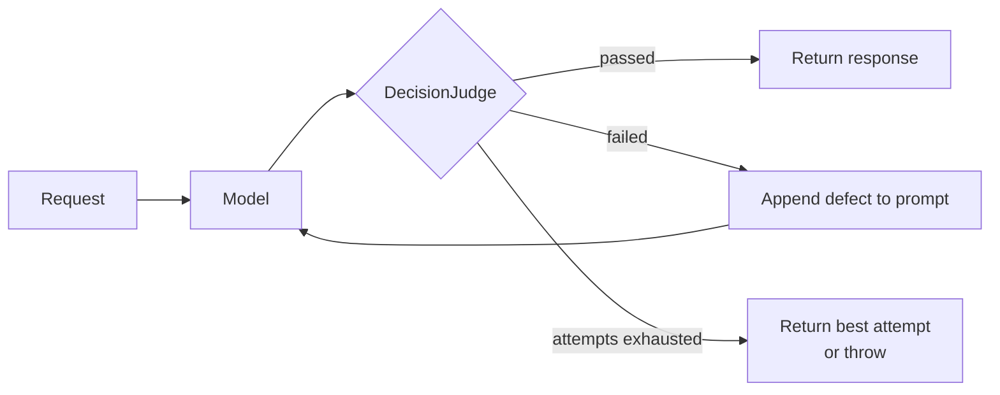

# DecisionSelfRefineAdvisor

A self-refine `CallAdvisor`: it judges every model response with a
[`DecisionJudge`](../judge/DecisionJudge.md) and, when the response falls short, feeds the
defect back into the prompt and tries again.

```xml
<dependency>
    <groupId>org.springaicommunity</groupId>
    <artifactId>spring-ai-decision-self-refine</artifactId>
</dependency>
```

It brings the judge with it.

## How it works



This is the same loop as an LLM-as-a-judge advisor, with the judging step swapped. A judge
model has to be prompted, has to generate text and has to be coerced into a schema. A
decision model is asked typed questions and answers them directly, so the verdict needs no
parsing and cannot come back malformed.

## Quick Start

```java
ChatClient chatClient = ChatClient.builder(chatModel)
    .defaultTools(new WeatherTools())
    .defaultAdvisors(DecisionSelfRefineAdvisor.builder()
            .judge(judge)
            .maxRepeatAttempts(3)
            .build())
    .build();

String answer = chatClient.prompt("What is the weather in Paris?").call().content();
```

## Builder Configuration

| Builder method | Default | Description |
|---|---|---|
| `judge(DecisionJudge)` | — (**required**) | What to evaluate each response against. |
| `maxRepeatAttempts(int)` | `3` | Retries after the first attempt. Capped at `MAX_REPEAT_ATTEMPTS_LIMIT` (100). |
| `failOnExhaustedAttempts(boolean)` | `false` | Throw `DecisionSelfRefineFailedException` instead of returning the best attempt. |
| `skipEvaluationPredicate(BiPredicate<ChatClientRequest, ChatClientResponse>)` | skips [what is not the model's answer](#what-is-not-judged) | When it returns `true`, the response is returned unjudged. |
| `judgeErrorPolicy(JudgeErrorPolicy)` | `FAIL_OPEN` | What to do when the judging call itself fails. See [when judging fails](#when-judging-fails). |
| `transientErrorPredicate(Predicate<Throwable>)` | `DecisionSelfRefineAdvisor::isTransient` | Which judging failures count as an outage rather than a misconfiguration. |
| `order(int)` | `DEFAULT_ORDER` (`LOWEST_PRECEDENCE - 2000`) | Where in the advisor chain this runs; `BEFORE_TOOLS_ORDER` to re-run tools on a retry. See [where it sits](#where-it-sits-and-why). |

!!! note "Retry until it passes is not supported"
    `maxRepeatAttempts` is capped deliberately. Each attempt is a model call *plus* a
    judging call, and a criterion the model cannot satisfy would otherwise loop forever.

## What the judge can see

The advisor builds a
[`DecisionJudgeInput`](../judge/DecisionJudge.md#the-input-a-judge-builds) from the original
request and the answer it produced:

| Field | Carries |
|---|---|
| `user_question` | the system message and the user and assistant turns, each prefixed with its role |
| `assistant_answer` | the final answer |
| `tool_calls` | the tool calls with their results, `{name, arguments, result}`: read from the prompt at the default order, recorded during the attempt at `BEFORE_TOOLS_ORDER` (see [where it sits](#where-it-sits-and-why)) |

The input is built from the **original** request, not the one carrying feedback, so the
judge never sees its own previous feedback as part of the question.

`supporting_context` and `expected_output` are not filled: the advisor has no retrieved
documents or reference answer to put there. Context a retrieval advisor added to the prompt
arrives inside `user_question`. So a criterion that reads `supporting_context`, or an
`appliesWhen` on `input.context()`, sees nothing under this advisor; write groundedness
against `user_question` or `tool_calls` instead.

Read from the prompt, a `ToolResponseMessage` carries no text of its own, so its results are
unpacked into `tool_calls` rather than dropped. Each result goes to the earliest open call
with the same id, or with the same tool name when the provider leaves ids blank, so parallel
calls and ids reused across turns stay apart. Tool calls of earlier turns still in the
prompt are included too. Write a groundedness criterion against that field:

```java
.yesNo("is_grounded", YesNoQuestion.builder()
    .text("Is every value in `assistant_answer` supported by a result in `tool_calls`?")
    .whenNo("States a value no tool returned")
    .build(), 0.7d)
```

Whether a tool was called at all is better settled by a
[code check](../judge/DecisionJudge.md#code-criteria) than asked of the model.

A response can hold several generations: thinking blocks, an answer split into parts, or
several choices. The judged answer is the text of the **first choice**, with thinking left
out and its parts joined.

## What a retry is told

A retry's user message is the original one, followed by:

1. the reasons the last answer was rejected, in the judge's own wording;
2. the reasons **earlier** answers were rejected that the last one no longer shows, so a
   retry does not fix one defect by bringing another back;
3. the rejected answer itself, so the model corrects what it wrote rather than starting
   blind.

```text
What is the weather in Paris?

Your previous answer was rejected by an automated evaluation for these reasons:
- helpfulness: rated "Terrible: irrelevant or off-topic" (0.00), needs to reach 2.00 which is "Mostly helpful: minor gaps remain"

Answers before it were rejected for these reasons, which must not come back:
- is_plausible: Contains an impossible or absurd value (scored 0.03, needs at least 0.70)

This is the answer that was rejected:
<rejected_answer>
No idea.
</rejected_answer>

Answer again, correcting every point above.
```

The message is rebuilt from the **original** request each time, and only the latest
rejected answer is quoted, so the prompt does not grow with every attempt. Everything stays
in the one user message: an advisor further in that reads the last user message, such as
retrieval, still finds the question there.

## What is not judged

A response that is not the model's answer is returned as it is. The default
`skipEvaluationPredicate` covers four cases:

| Response | Why it is not judged |
|---|---|
| a tool call | It is not an answer yet. |
| the output of a `returnDirect` tool | It is the tool's output, and a retry would re-run a tool that may have side effects. |
| the notice of an exceeded tool-call limit | It is the tool loop's message; every retry would run the tools into the same limit again. |
| a turn the [guardrail](../guardrails/DecisionGuardrailAdvisor.md) refused | It is the guardrail's wording, and the guardrail would refuse again. |

A custom predicate replaces that default, so keep these checks if you write your own.

## Where it sits, and why

The advisor's position in the chain decides what the judge sees and what a retry can fix.
`ChatClient` runs the tool loop in a `ToolCallingAdvisor` it registers itself, at
`HIGHEST_PRECEDENCE + 300`. A chat memory advisor, when the application adds one, runs at
`HIGHEST_PRECEDENCE + 200` by default. Retrieval (`RetrievalAugmentationAdvisor`) and most
application advisors run at order `0`.

| Order | The judge sees | A retry | Fits |
|---|---|---|---|
| `DEFAULT_ORDER` (`LOWEST_PRECEDENCE - 2000`), inside everything above | the retrieved context and the tool calls, read from the prompt | re-asks the model with the same context and tool history; retrieval and tools are **not** re-run | most chains, and anything with retrieval |
| `BEFORE_TOOLS_ORDER` (`HIGHEST_PRECEDENCE + 250`), between memory and the tool loop | the tool calls, **recorded** during each attempt; **not** the retrieved context | re-runs the tools, so a tool that returned something wrong can return something else | tool-heavy chains without retrieval, where a bad tool result is the usual failure |

Both positions sit inside chat memory at `HIGHEST_PRECEDENCE + 200`, so memory records only
the answer finally returned.

!!! note "Session memory"
    Spring AI 2.1 deprecates `MessageChatMemoryAdvisor` in favour of the session advisors
    (`SessionAdvisors`). Those run in two places: the turn advisor at
    `HIGHEST_PRECEDENCE + 200`, and the memory advisor *inside* the tool loop, at
    `HIGHEST_PRECEDENCE + 1000`. Both are outside this advisor's default order. At
    `BEFORE_TOOLS_ORDER`, however, the session memory advisor is inside the retry loop, so
    it sees every attempt and not only the final answer.

At `BEFORE_TOOLS_ORDER` the attempt's tool traffic never reaches this advisor's prompt, so
it is recorded instead: for each attempt, the request's tool callbacks are wrapped, and
every call lands in `tool_calls` with its arguments and result. That position is also
outside every advisor at order `0`: retrieval re-runs on each attempt, with the judge's
feedback in its query, and the judge's `user_question` does not contain the retrieved
context.

!!! note "Recorded tools"
    Tools passed as callbacks, through `ChatClient.tools(...)` or `defaultTools(...)`, are
    recorded. A tool resolved by name through a `ToolCallbackResolver` is not. A recorded
    call that threw is noted as `error: <message>`, which may differ from the text the model
    was shown.

### When a retry asks for a tool

At the default order the advisor is inside the tool loop, and a retry is meant to re-ask the
model with the tool results it already has. If the model answers a retry with **another tool
call**, refining stops there and the best answer so far is returned (or
`DecisionSelfRefineFailedException` is thrown, with `failOnExhaustedAttempts`).

Running that tool would hand the turn back to the tool loop, which re-enters this advisor
with no memory of the attempts already made. `maxRepeatAttempts` could not be kept, and the
tools would run again on every round. When a failure is best fixed by calling the tools
again, use `BEFORE_TOOLS_ORDER`, where every retry runs the whole tool loop.

## Failing hard

By default the advisor returns the **best attempt** once attempts run out: the one with the
most criteria passed net of those failed, the later one on a tie. A later attempt is not
necessarily a better one, so the last is not returned just for being last; and an attempt
that `failFast` or an unmet dependency left mostly unjudged passes little, so it does not
win by default. Turn that around where shipping a rejected answer is worse than failing:

```java
DecisionSelfRefineAdvisor.builder()
    .judge(judge)
    .maxRepeatAttempts(2)
    .failOnExhaustedAttempts(true)   // throws DecisionSelfRefineFailedException
    .build();
```

```java
catch (DecisionSelfRefineFailedException ex) {
    log.error("gave up: {}", ex.verdict().summary());
    ex.verdict().failures().forEach(f -> log.error("  {}", f.detail()));
}
```

## When judging fails

An outage of the decision model says nothing about the answer. By default the advisor
**fails open** on transient failures: it logs a warning and returns the response it could
not judge, rather than failing a chat call whose answer may be fine.

Any other failure, such as a bad API key or an invalid question, is a misconfiguration
rather than an outage. It is **always rethrown**, so it cannot silently turn judging off.

Which failures are transient depends on the provider, and the `DecisionModel` API has no
common exception for it. By default (`DecisionSelfRefineAdvisor.isTransient`) a failure
counts when it, or one of its causes, is an `IOException`, an `UncheckedIOException`, a
`TimeoutException` or Spring AI's `TransientAiException`. A provider that reports a rate limit or a server error with an
exception of its own is not covered; add its test:

```java
DecisionSelfRefineAdvisor.builder()
    .judge(judge)
    .transientErrorPredicate(((Predicate<Throwable>) DecisionSelfRefineAdvisor::isTransient)
            .or(SystemOneRetryUtils::isTransient))   // System One and Ollama models
    .build();
```

Where an unjudged answer must never ship, fail closed instead. Every failure of the judging
call is then rethrown:

```java
DecisionSelfRefineAdvisor.builder()
    .judge(judge)
    .judgeErrorPolicy(DecisionSelfRefineAdvisor.JudgeErrorPolicy.FAIL_CLOSED)
    .build();
```

The policy applies to whatever `judge.judge(...)` throws, and that includes the judge's own
code checks and `appliesWhen` predicates, which run inside it. An exception from a check is
a bug in the check and is rethrown like any other non-transient failure; but a check that
throws something the transient predicate accepts, such as an `UncheckedIOException` from
reading a file, is treated as an outage and the answer is returned unjudged. Keep I/O out
of checks.

A criterion the model *refuses* to answer is not a failure of the call at all: it is an
`ERROR` finding in the verdict, which blocks only when the judge is built with
`failOnError(true)`.

## Ordering with the guardrail advisor

The two compose, and they do different jobs. The recommended setup screens the request
before anything else and every reply right next to the model:

```java
.defaultAdvisors(
    DecisionGuardrailAdvisor.input(decisionModel),                   // safety, once per turn
    DecisionSelfRefineAdvisor.builder().judge(judge).build(),        // quality, retries
    DecisionGuardrailAdvisor.output(decisionModel))                  // safety, every attempt
```

The output guardrail sits *inside* the self-refine loop, nearer the model. It screens every
attempt, so an unsafe draft is replaced by the refusal before it is judged. The input
guardrail sits outside it, so it screens what the person wrote rather than a message with
the judge's feedback appended. See
[where the guardrail sits](../guardrails/DecisionGuardrailAdvisor.md#where-it-sits).

Retrying does not help a guardrail: an unsafe answer is not a draft. So a turn the guardrail
refuses is final. The refusal is marked in the response context
(`DecisionGuardrailAdvisor.OUTCOME_CONTEXT_KEY`), and the default `skipEvaluationPredicate`
does not judge or retry it.

## Streaming

`adviseStream` is unsupported and returns `Flux.error(UnsupportedOperationException)`. A
verdict needs the whole answer, so there is nothing useful to emit incrementally.

## See Also

- [DecisionJudge](../judge/DecisionJudge.md): the criteria this advisor evaluates
- [DecisionGuardrailAdvisor](../guardrails/DecisionGuardrailAdvisor.md)
- [Providers](../concepts/providers.md#failures-and-retries): what each provider throws
